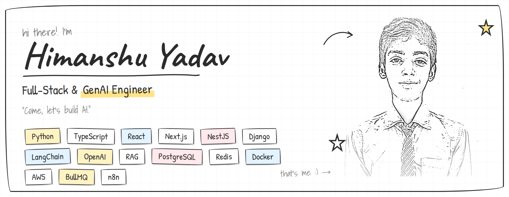

# Himanshu Yadav

> *"Come, let's build AI."*

**Full-Stack & GenAI Engineer** — I build production AI systems: LLM orchestration, RAG pipelines, and multi-tenant SaaS platforms.

Currently Full-Stack GenAI Developer at **Romegamart (ROMEGA MART LLP)**. Previously at **PRP WEBS**. B.Tech in Computer Science & Design (AKTU).

[LinkedIn](https://www.linkedin.com/in/himanshu-yadav-5ba28921b/) · [LeetCode](https://leetcode.com/u/himanshuyadav45/) · [GitHub](https://github.com/gitmanhimanshu) · [Email](mailto:himanshuyada70@gmail.com)

---

## About

I focus on shipping AI-first products end to end — from designing self-correcting generation pipelines to building the SaaS platforms around them. I care about clean architecture, scalable systems, and code that holds up in production.

- Building AI-first products at Romegamart, India's largest B2B marketplace for the RO & water purifier industry — live with 100K+ users
- Working with agentic AI, LLM orchestration, MCP servers, and workflow automation
- Solved 500+ problems on LeetCode

---

## Experience

**Full-Stack GenAI Developer — Romegamart (ROMEGA MART LLP)**
*Jun 2026 – Present · Gurugram, Haryana*

- Core developer building **Romegamart**, India's first & largest B2B marketplace for the RO & water purifier industry — live on Play Store and App Store with 100K+ real users across India.
- Designed and shipped end-to-end features across web and mobile using React, Python, Django, and PostgreSQL, powering a multi-stakeholder marketplace connecting manufacturers, wholesalers, distributors, and retailers.
- Built high-throughput RESTful APIs with Django REST Framework, JWT authentication, caching, and query optimization to handle catalog browsing, search, and order flows at 100K+ user scale.
- Built a custom **MCP (Model Context Protocol) server** for the Romegamart sales team to track user activity events, monitor expressed interests, and surface interest-based insights — enabling AI assistants to query and act on user behavior in real time.
- Implemented secure payment and order management with verified-supplier onboarding, real-time notifications, and encrypted transactions.
- Optimized API response latency and app load times, improving stability and experience for a growing pan-India user base.

**Full-Stack GenAI Developer — PRP WEBS**
*Feb 2025 – Mar 2026 · Jaipur, Rajasthan*

- Built production web applications with Django, Node.js, Express, React, and MongoDB; integrated GenAI features (chatbots, content generation) via OpenAI APIs.
- Engineered a speech-to-text pipeline (Sarvam AI) with transcript correction and meeting summarization.
- Built REST APIs with JWT auth, rate limiting, and documentation; improved application performance by ~40% through code splitting and database indexing.
- Worked in an Agile environment, conducted code reviews, and mentored junior developers.

**Teaching Assistant, DSA with Java — Apna College**
*Dec 2024 – May 2025 · Remote*

- Mentored 50+ students in data structures and algorithms; created tutorials covering arrays, trees, graphs, and dynamic programming.
- Maintained a 95% satisfaction rate in student feedback for doubt-solving sessions.

---

## Selected Projects

**[Momentum — AI Social Media Automation SaaS](https://momentum.hypeliv.com)**
`NestJS` · `Next.js` · `TypeScript` · `BullMQ` · `Redis` · `PostgreSQL` · `Drizzle`

Multi-tenant SaaS for AI-generated social content across Instagram, LinkedIn, YouTube, TikTok, Facebook, and X. Features a self-correcting 5-step Brand-to-Image pipeline (ideate → score → prompt → image → vision-verify), Autopilot for hands-free generate → verify → schedule → publish, an AI Character Studio for consistent characters, and prompt-to-story UGC reels. Integrated Anthropic Claude, OpenAI GPT, Google Gemini, Heygen, Kling, Sarvam AI, ElevenLabs, and Replicate behind a unified provider-routing layer. Built Razorpay subscriptions and social OAuth publishing with encrypted token storage.

**[Romegamart — B2B Marketplace for RO & Water Purifier Industry](https://romegamart.com)**
`React` · `Python` · `Django` · `PostgreSQL` · `DRF` · `MCP`

India's first & largest B2B marketplace for the RO & water purifier industry, live on Play Store and App Store with 100K+ users. Built a custom MCP server for the sales team to track user activity, monitor interests, and surface AI-driven insights. High-throughput REST APIs with JWT auth, caching, and query optimization; secure payments, verified-supplier onboarding, and real-time notifications.

**[WePlayed — Sports Video Analytics Platform](https://app.weplayed.com)**
`Python` · `Django` · `OpenCV` · `PostgreSQL` · `Celery` · `Docker` · `AWS`

Automated highlight generation through frame-level analysis, with live play-by-play aligned to video timelines using computer vision. Async processing via Celery + Redis, deployed as containerized microservices on AWS.

**[Dyzo.ai — AI Productivity Platform](https://dyzo.ai)**
`Python` · `Django` · `React` · `PostgreSQL` · `LLMs` · `Razorpay`

AI assistant built on GPT models with a dynamic query generator, voice-based task creation via Sarvam AI, and AI-powered onboarding. Reached 300+ active users and reduced task-management time by ~35%.

**[Setu — AI Gmail Automation Platform](https://setu.mimanasa.online)**
`Python` · `FastAPI` · `MCP` · `OAuth 2.0` · `Gmail API` · `Redis` · `Docker`

Open-source AI-powered email automation platform that automates research, drafting, and Gmail sending with user approval. Includes an MCP server enabling AI assistants like Claude, ChatGPT, and Cursor to securely automate Gmail workflows.

**[django-rmoditor — Django Rich Text Editor](https://pypi.org/project/django-rmoditor/)**
`Python` · `Django` · `JavaScript` · `HTML`

Self-hosted WYSIWYG editor published on PyPI. Provides configurable toolbars, HTML sanitization, and Django Form/Admin integration.

**[CodeStats Analyzer — Python Code Quality CLI](https://pypi.org/project/codestats-analyzer/)**
`Python` · `AST` · `CLI` · `Static Analysis`

AST-based CLI tool published on PyPI that analyzes Python codebases for complexity, maintainability, code smells, and code-quality metrics.

---

## Technical Skills

**Languages** — Python, TypeScript, JavaScript, Java, C, HTML5/CSS3

**AI / GenAI** — LangChain, LangGraph, LlamaIndex, OpenAI, Anthropic Claude, Gemini, Hugging Face, RAG, Vector Databases, Prompt Engineering, Fine-Tuning, Multi-Agent Systems, Agentic AI, MCP, n8n, TensorFlow, scikit-learn, OpenCV

**Frontend** — React, Next.js, Redux, Tailwind CSS, Material UI

**Backend** — Node.js, NestJS, Express, Django, Django REST Framework, FastAPI, GraphQL, REST APIs

**Databases** — PostgreSQL, MongoDB, MySQL, Redis, Supabase, Firebase

**DevOps & Tools** — Docker, AWS, Nginx, Linux, Git, GitHub, CI/CD, Postman, Celery, BullMQ, Cron Jobs

**Payments** — Razorpay, RevenueCat, Payment Gateway Integration

**Mobile** — Android (Java), React Native (Basic)

---

## Education

**B.Tech, Computer Science & Design** — R R Institute of Modern Technology (AKTU) · CGPA 8.1
*Sep 2021 – 2025 · Lucknow, UP*

---

## Achievements

- Winner, Code-A-Thon 2024 (Even & Odd Semesters) — 150+ participants
- 1st Place, AKTU Coding Ninjas Competition (Sept 2024)
- Top 5% on LeetCode — 500+ problems solved
- 1st Place, College Tech Fest 2022 (Pragyan) — Software Development
- Volunteered in Robotics Workshop impacting 100+ students (March 2024)

---

 

